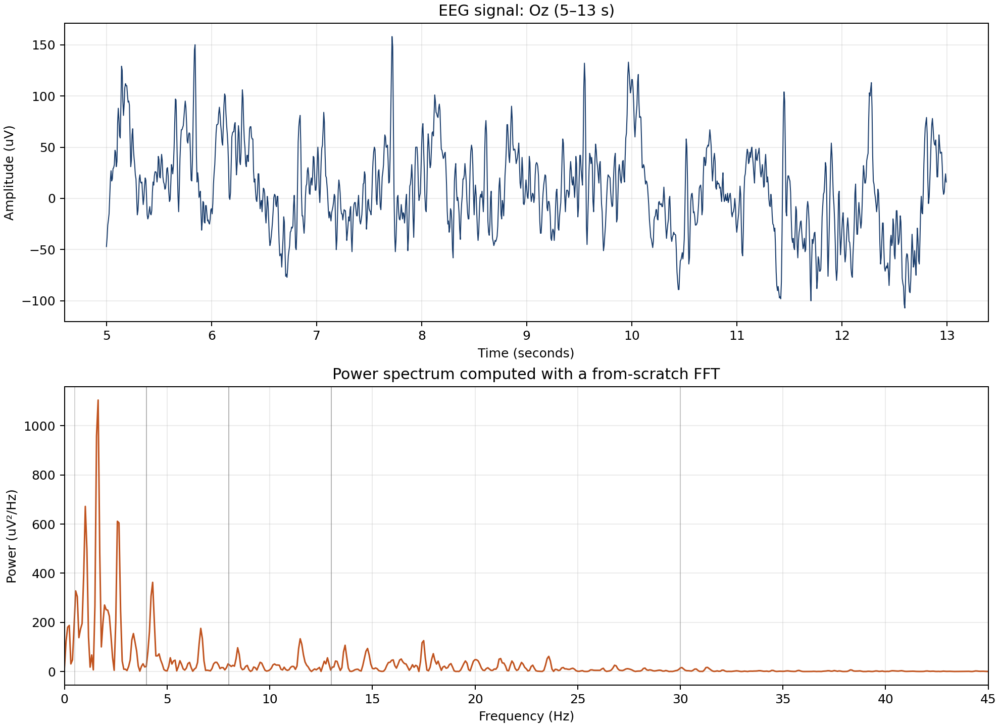

# Fourier Transform: Finding the Frequencies Hidden in EEG

## One-sentence thesis

An EEG looks irregular in time, but the Fourier transform decomposes it into
the frequencies that make up that signal.

---

## 1. Start with the question

Show the first panel of the figure below and ask:

> “This is a voltage signal measured over time. Which rhythms are hidden in it?”



**Say:** The top graph is a real EEG signal from electrode `Oz`, located near
the back of the head. The bottom graph is the same segment viewed by frequency
instead of time. The transformation from the first graph to the second is the
topic of this project.

---

## 2. What EEG measures

EEG stands for **electroencephalography**. Small electrodes placed on the scalp
measure changing voltage differences caused by the combined electrical activity
of many neurons. It is not a direct measurement of a single neuron or a
thought.

For this project:

| Property | Value |
| --- | --- |
| Recording | `S001R01.edf` |
| EEG channels | 64 |
| Example electrode | `Oz` (occipital) |
| Sampling rate | \(F_s=160\text{ Hz}\) |
| Recording duration | 61 seconds |

The computer records the signal every \(1/160\) of a second. Those recorded
values are the samples used by the DFT and FFT.

> Important: A frequency spectrum describes a signal. It does not by itself
> diagnose a person or a medical condition.

---

## 3. Begin with a familiar idea: periodic waves

Any sufficiently well-behaved periodic signal with period \(T\) can be written
as a sum of harmonics:

$$
x(t)=\sum_{k=-\infty}^{\infty}c_k e^{ik\omega_0t},
\qquad \omega_0=\frac{2\pi}{T}.
$$

Each coefficient \(c_k\) tells us the amount of the frequency
\(k\omega_0\). The complex exponential is simply a compact way to represent a
sine and cosine together:

$$
e^{i\omega t}=\cos(\omega t)+i\sin(\omega t).
$$

**Say:** Fourier series work beautifully for repeating signals. But the EEG
segment does not repeat forever, so we need the continuous-frequency version.

---

## 4. The key derivation: make the period infinite

The Fourier-series frequency spacing is

$$
\Delta\omega=\frac{2\pi}{T}.
$$

As \(T\to\infty\), the spacing \(\Delta\omega\to0\). The discrete
frequencies become continuous, and the Fourier-series sum becomes an integral.
That limit gives the Fourier transform:

$$
\boxed{X(\omega)=\int_{-\infty}^{\infty}x(t)e^{-i\omega t}\,dt.}
$$

The inverse transform rebuilds the original signal:

$$
\boxed{x(t)=\frac{1}{2\pi}\int_{-\infty}^{\infty}X(\omega)e^{i\omega t}\,d\omega.}
$$

**Main insight:** Time-domain information and frequency-domain information are
two descriptions of the same signal.

For every algebraic step, see [the complete derivation](derivation.md).

---

## 5. Real computers use the DFT

An EEG machine does not store a continuous curve; it stores \(N\) samples:

$$
x[0],x[1],\ldots,x[N-1].
$$

The discrete Fourier transform is

$$
\boxed{X[k]=\sum_{n=0}^{N-1}x[n]e^{-i2\pi kn/N}.}
$$

The frequency for bin \(k\) is

$$
f_k=\frac{kF_s}{N}.
$$

This presentation analyzes eight seconds of EEG, so

$$
N=8\times160=1280,
\qquad
\Delta f=\frac{F_s}{N}=\frac{160}{1280}=0.125\text{ Hz}.
$$

The highest frequency we can represent is the Nyquist frequency:

$$
\frac{F_s}{2}=80\text{ Hz}.
$$

---

## 6. Why a *fast* Fourier transform?

A direct DFT requires about \(N^2\) operations. The FFT gives exactly the
same result, but it divides the input into even and odd samples repeatedly:

$$
X[k]=E[k]+e^{-i2\pi k/N}O[k],
$$

$$
X[k+N/2]=E[k]-e^{-i2\pi k/N}O[k].
$$

This reduces the calculation to approximately \(N\log_2N\) operations.

**Say:** The fast in FFT is not a different transform. It is a smarter method
for calculating the same DFT.

The code in [fft_from_scratch.py](fft_from_scratch.py) implements this
recursive Cooley--Tukey algorithm, rather than hiding it inside a library call.

---

## 7. Applying the FFT to the real recording

The program does four things to the selected `Oz` segment:

1. Reads the sampled voltage values from the EDF file.
2. Subtracts the mean and applies a Hann window to reduce edge effects.
3. Pads to 2048 values so the recursive radix-2 FFT can run.
4. Calculates power \(\lvert X[k]\rvert^2\) and plots it against frequency.

The bands commonly discussed in EEG are:

| Band | Frequency range |
| --- | --- |
| Delta | 0.5–4 Hz |
| Theta | 4–8 Hz |
| Alpha | 8–13 Hz |
| Beta | 13–30 Hz |
| Gamma | 30–80 Hz |

The spikes in the lower plot mean that particular frequencies contributed more
strongly to this selected segment. They are a mathematical observation of this
recording, not a conclusion about a subject’s health or mental state.

---

## 8. Final takeaway

The route through the project is:

```text
periodic waves → Fourier series → infinite-period limit → Fourier transform
      → sampled EEG → DFT → FFT → frequency spectrum
```

The Fourier transform does not destroy information—it changes the question
from **“how does this signal change over time?”** to **“which frequencies make
up this signal?”**

## Questions you may be asked

**Why are there negative frequencies?**  They come from the complex-exponential
description. For a real EEG signal, the negative-frequency half mirrors the
positive-frequency half, so the plot shows the positive half.

**Why use a window?**  The selected segment has abrupt ends. A Hann window
softens those edges, preventing their sharp discontinuities from spreading
energy across many frequencies.

**Does zero-padding improve the true resolution?**  No. It makes the FFT
compatible with this radix-2 implementation and creates a smoother-looking
set of sampled frequencies. The meaningful resolution still comes from the
eight-second observation window: \(0.125\text{ Hz}\).

**Could NumPy do this in one line?**  Yes. This project implements the FFT from
scratch so the mathematical algorithm is visible, then checks it against NumPy
for correctness.
